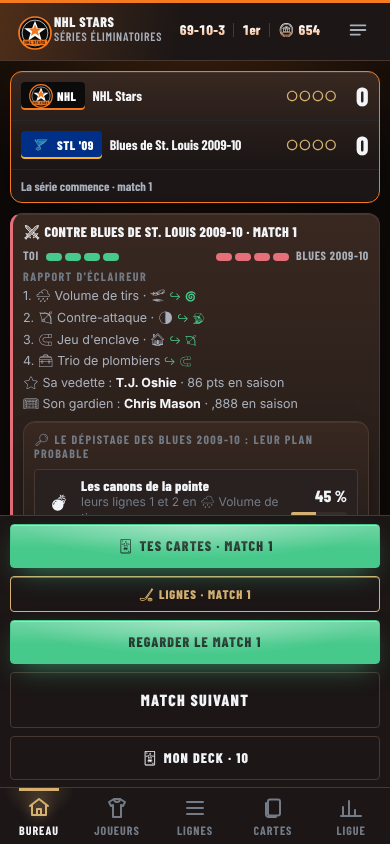
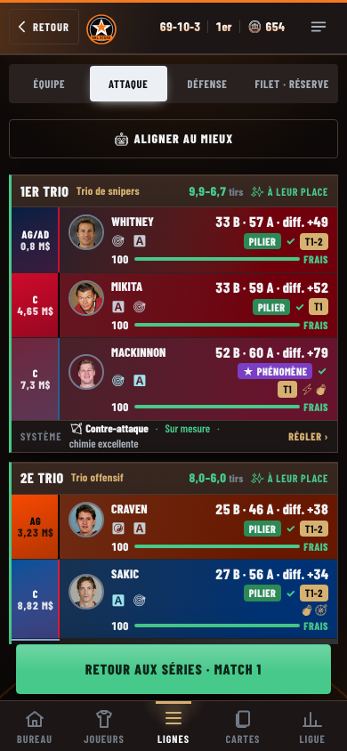
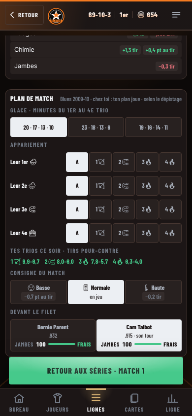
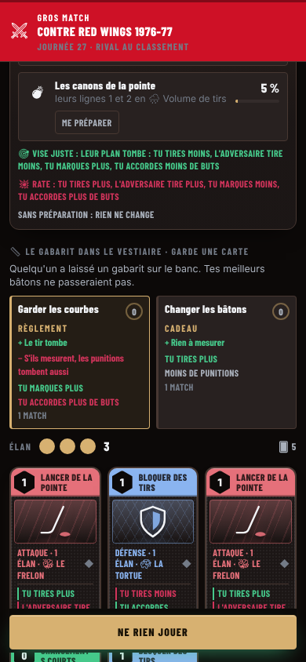
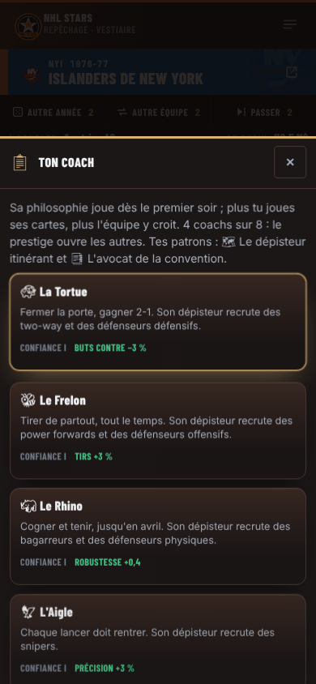
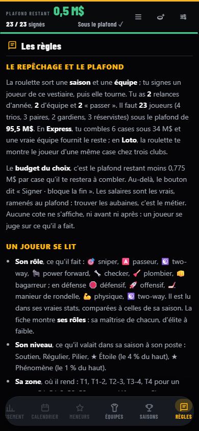

# Cap 82-0

Bâtis un alignement de 23 joueurs de la LNH — n'importe quelle saison depuis 1970-71, n'importe quelle équipe y compris les franchises disparues — sous le plafond salarial, et vois si ta formation peut faire une saison parfaite.

Chaque tour, la roulette sort une saison et une équipe. Tu piges dans ce vestiaire-là. Tu vois les vraies stats et le salaire. Aucune cote ne s'affiche, ni avant ni après : un joueur se juge sur ce qu'il a fait, et la simulation joue lancer par lancer sur ses vraies colonnes.

## Les modes

- **Le 82-0** : le repêchage, rien d'autre. Vestiaire (une équipe entière) ou loto (le même joueur de trois clubs), dans toutes les époques, dans la saison de la ligue ou dans l'histoire d'une franchise (relocalisations comprises). La saison se simule d'un coup ; les séries se regardent match par match.
- **Le Rogue** : une run de plusieurs saisons, au jour le jour. Ton club part en NHL Stars avec des bouche-trous et quelques jetons 🪙 ; la boutique vend des packs de joueurs et de cartes, et chaque saison le proprio en veut plus (le mandat). Un **coach** en poste — neuf philosophies, du 🐝 Frelon à la 🐢 Tortue — gagne la confiance de l'équipe (I, II, III) à mesure que tu joues des cartes de sa couleur. Tes cartes tiennent dans **trois places** et se jouent quand tu veux ; les **gros matchs** et les séries sont des duels en trois périodes, où l'adversaire annonce ses intentions et où tu réponds par un geste ou une carte de ton deck de match (20 cartes au plus, deux d'élan par période). Les médailles 🏅 et le cartable restent d'une run à l'autre et ouvrent les déblocages.
- **Sur table** : le même alignement, joué comme un jeu de plateau à la Blood Bowl, en tournoi de six clubs.
- **L'exhibition** : deux vrais clubs de n'importe quelle époque, joués par le même moteur — un match, une série 4 de 7, ou cent matchs pour lire les chances.

L'écran est celui d'un directeur général, en cinq sections qui ne bougent jamais, chacune pour une question : **Bureau** (qu'est-ce qui se passe aujourd'hui ?), **Joueurs** (qui j'ai, et dans quel état ?), **Lignes** (comment on joue ce soir ?), **Cartes** (avec quoi je joue ?), **Ligue** (où j'en suis ?). Un choix se dit en vraies stats de match — tirs, % au tir, tirs contre, % d'arrêts —, jamais en note.

## Jouer

Le jeu est un site statique qui se joue en local. Aucun compte, aucun serveur distant.

```bash
python3 scripts/build_shards.py --seed-only   # ~10 saisons, 2 minutes
python3 -m http.server 8000
```

Ouvre http://localhost:8000. Les modules ES exigent `http://`, pas `file://`.

Au repêchage, chaque carte dit l'essentiel : le poste, le salaire, le chiffre clé, le rôle, la zone d'efficacité et la case où le joueur irait. Un toucher ouvre sa fiche — ses vraies statistiques, son salaire d'époque, ce que le moteur fera de lui sur la glace.

Pour la base complète — 1970-71 à aujourd'hui, tout joueur à 10+ matchs :

```bash
python3 scripts/build_shards.py
```

Environ 120 requêtes à l'API officielle de la LNH, 5 minutes. Requiert Python 3 et Node 18+, aucune dépendance à installer.

Pour refaire seulement la cote globale, les salaires, les archétypes et les zones (aucun réseau, une seconde) :

```bash
python3 scripts/build_shards.py --rerate
node scripts/check_ratings.mjs      # distribution des cotes et cohérence avec les vrais classements
```

## En images (1.0, à 390 px)

| Le Bureau, en séries | Les Lignes |
|---|---|
|  |  |

| Le plan de match, selon le dépistage | La main d'un gros match |
|---|---|
|  |  |

| Ton coach | Les règles |
|---|---|
|  |  |

## Android et bureau

Le jeu n'est plus publié en ligne : il se joue en local, dans le navigateur, sur Android (`mobile/`, Capacitor) ou sur Windows (`desktop/`, Electron).

```powershell
powershell -ExecutionPolicy Bypass -File mobile\fabriquer-apk.ps1   # l'APK signé, dans mobile\Cap-82-0.apk
```

`mobile/assembler-www.mjs` regroupe et minifie le jeu (esbuild, devDependency de `mobile/` seulement) ; les salaires et le filet `data/seed.json` restent hors de l'APK.

La GitHub Action « Bâtir les données » existe encore pour régénérer les shards depuis l'API de la LNH (modes `full`, `bios`, `rerate`, `seed`) ; en local, `scripts/build_shards.py` fait la même chose.

**L'application Android** (`mobile/fabriquer-apk.ps1`) n'emporte pas les 3 900 visages recadrés (57 Mo) : l'APK n'a que les écussons et la silhouette. Au premier lancement, en arrière-plan, l'appareil télécharge chaque portrait au site de la LNH, le recadre lui-même avec le code de `scripts/portraits.mjs` (`js/recadrage.js`) et le garde dans son cache (`js/visages.js`). En attendant, la photo brute de la LNH s'affiche ; hors ligne, la silhouette. Le jeu marche hors ligne dès que cette passe est faite.

## Comment les cotes sont calculées

Elles sont dérivées des vraies stats, pas inventées, et **normalisées par saison**. Chaque joueur est mesuré en z-score contre ses contemporains. C'est ce qui fait que 100 points en 1982 et 100 points en 2004 ne donnent pas la même cote offensive — sinon les années 80 écraseraient tout.

| Cote | Dérivée de |
|---|---|
| Offensive | points/match, tirs/match, points en avantage numérique |
| Défensive | +/-, points en désavantage, temps de glace, tirs bloqués, bonus positionnel pour les défenseurs |
| Robustesse | minutes de punition/match, mises en échec (2005+) |
| Clutch | buts gagnants et en prolongation |

Gardiens : Technique (% d'arrêts), Blindage (moyenne de buts alloués), Robustesse (charge de travail), Clutch (blanchissages, % de victoires).

La cote globale ajoute un bonus de vedette calculé sur le rang du joueur dans sa saison, divisé par le nombre d'équipes de la ligue cette année-là : un top-10 des marqueurs vaut la même chose en 1975 qu'en 2024. Les 100+ points de l'ère moderne tombent entre 88 et 99.

Le salaire suit un barème par cote globale sur le plafond de 95,5 M$ (cote 70 → 2,3 M$, 80 → 5,6 M$, 88 → 11,5 M$, 99 → 18,5 M$). Un joueur de 100+ points coûte 12 à 18 M$, un défenseur de première paire 9 à 14 M$, et le premier contrat d'un joueur de 24 ans ou moins est un contrat d'entrée plafonné selon l'époque (rien avant 1995-96, base + bonis ensuite). Quand un salaire réel publié existe (`data/salaries/`), il remplace le barème au prorata du plafond de l'année ; pour 1989-90 à 2003-04, le « plafond » est la masse salariale de l'équipe la plus dépensière.

Chaque joueur porte aussi un archétype classique (franc-tireur, fabricant de jeu, attaquant de puissance, défenseur offensif…) et une zone d'efficacité (calibre 1er, 2e, 3e ou 4e trio) : un trio où chacun est dans sa zone joue mieux, et la chimie d'une ligne suit ce que le système demande à ses joueurs.

## La simulation

Une ligue complète : ta formation plus les vraies équipes historiques sorties par la roulette, alignées par l'IA, au jour le jour sur un vrai calendrier — rien n'est simulé d'avance, une décision s'applique au jour dit. Puis les séries, 4 de 7, pour les seize premiers au plus.

Le moteur joue chaque match **lancer par lancer** ([MOTEUR.md](MOTEUR.md)). Le rythme du hockey n'a presque pas bougé en 55 ans (28 à 29 lancers par équipe par match) ; ce qui a changé, c'est le % au tir et le % d'arrêts. L'événement de base est donc le lancer, et chaque époque garde son % de tir et son % d'arrêts de ligue : 100 points en 1982 et 100 points en 2004 ne valent pas la même chose, et une équipe de 1985 rencontre une équipe de 2015 sur un pied d'égalité.

Les trios jouent 30 / 26 / 23,5 / 20,5 % du temps à forces égales, les paires 39 / 31,5 / 29,5 % : ton quatrième trio pèse pour vrai. Chaque unité joue un système (trappe, échec avant, contre-attaque…) qui demande des rôles ; un joueur rend selon ses badges (Sniper Or, Passeur Argent…), sa carrure fait l'agressivité de sa ligne, ses jambes s'usent et se refont. Buts et passes se distribuent comme sa vraie saison les a distribués. La même graine rejoue la même saison, au but près.

## Documentation

- [CLAUDE.md](CLAUDE.md) — conventions et règles pour les agents de code
- [AGENTS.md](AGENTS.md) — même chose, pour Jules et compagnie
- [ARCHITECTURE.md](ARCHITECTURE.md) — pourquoi le découpage par saison, les trois sources de données
- [LIVRAISON.md](LIVRAISON.md) — le plan de travail vers la 1.0
- [PLAN.md](PLAN.md) — état du projet, ce qui reste à faire
- [docs/](docs/README.md) — l'historique : décisions, référence du moteur, journal par sprint

## Données

Source : API publique de la LNH (`api.nhle.com/stats/rest`). Non affilié à la LNH.
